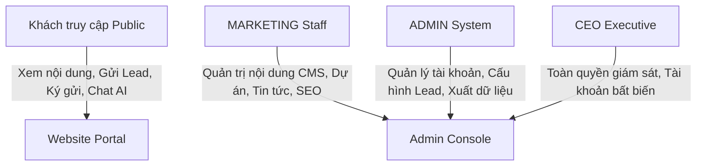

# TÀI LIỆU ĐẶC TẢ NGHIỆP VỤ HỆ THỐNG MAIAN HOMES 2.0

> **Phiên bản:** 2.0 (Chuẩn hóa toàn diện)  
> **Cập nhật:** 2026-10  
> **Áp dụng cho:** Toàn bộ nền tảng Website & Hệ thống Quản trị Maian Homes (`backend`, `frontend`)

---

## 1. TỔNG QUAN HỆ THỐNG & ĐỊNH VỊ DOANH NGHIỆP

### 1.1 Tầm nhìn & Lĩnh vực hoạt động
**Maian Homes** là nền tảng công nghệ bất động sản cao cấp, tích hợp trải nghiệm trực tuyến cho khách hàng và bộ công cụ quản trị tinh gọn (CMS & Lead Operations) cho doanh nghiệp. Hệ thống tập trung vào 3 mảng kinh doanh cốt lõi:
1. **Phân phối Dự án Bất động sản cao cấp:** Căn hộ hạng sang, biệt thự, khu đô thị phức hợp với trải nghiệm tham quan mặt bằng tầng, căn hộ và tiện ích tương tác cao.
2. **Dịch vụ Cho thuê Văn phòng (Office Leasing):** Cung cấp giải pháp văn phòng phân hạng chuyên nghiệp (**Hạng A, Hạng B, Hạng C**) tại các vị trí đắc địa.
3. **Không gian làm việc linh hoạt (Coworking Space):** Cho thuê chỗ ngồi linh hoạt (Hot Desk), chỗ ngồi cố định (Dedicated Desk) và văn phòng riêng trọn gói (Private Office).

### 1.2 Nguyên tắc kiến trúc nghiệp vụ
* **Đơn nguồn sự thật (Single Source of Truth):** Toàn bộ dữ liệu nghiệp vụ, trạng thái hiển thị, giá cả, chính sách phân quyền do Backend quản lý và bảo vệ nghiêm ngặt. Frontend không tự quyết định quy tắc nghiệp vụ.
* **Tự động hóa & Tinh gọn:** Loại bỏ hoàn toàn các quy trình nội bộ cồng kềnh (không có chấm công, chia ca, hay CRM nội bộ phức tạp). Hệ thống tập trung tối đa vào **Tiếp thị nội dung - Thu hút khách hàng (Lead Capture) - Trợ lý AI**.
* **Trợ lý AI được neo dữ kiện (AI Grounding):** Trợ lý ảo Maya chỉ phản hồi dựa trên thông tin đã được kiểm chứng trong kho tri thức doanh nghiệp (`company_knowledge`), tuyệt đối không phỏng đoán hay cam kết giá/pháp lý sai lệch.

---

## 2. MÔ HÌNH TÁC NHÂN & MA TRẬN PHÂN QUYỀN (RBAC)

Hệ thống quy định 3 vai trò nội bộ chính thống cùng với Khách truy cập công khai.



### 2.1 Bảng phân định trách nhiệm

| Tác nhân | Định danh | Trách nhiệm chính trong hệ thống |
| :--- | :--- | :--- |
| **Khách truy cập** | `PUBLIC` | Xem dự án, đọc bài viết, tìm văn phòng/coworking, tương tác trợ lý AI Maya, gửi form tư vấn, đăng ký ký gửi tài sản. |
| **Nhân viên Tiếp thị** | `MARKETING` | Soạn thảo và biên tập Dự án, Tin tức/Bài viết, Thư viện Media, Hồ sơ Chuyên gia, Tin tuyển dụng, Tối ưu SEO/GEO. |
| **Quản trị viên** | `ADMIN` | Quản lý tài khoản và phân quyền, giám sát tiếp nhận Lead & Ký gửi, xuất báo cáo dữ liệu, cấu hình liên hệ & thương hiệu. |
| **Giám đốc điều hành** | `CEO` | Quyền hạn tối cao, tài khoản được bảo vệ bất biến (không thể xóa hay khóa từ service layer), giám sát toàn bộ hoạt động. |

### 2.2 Ma trận quyền hạn chi tiết (`WEBSITE_PERMISSIONS`)

| Nhóm nghiệp vụ | Quyền hạn (Permission Key) | MARKETING | ADMIN | CEO |
| :--- | :--- | :---: | :---: | :---: |
| **Dự án (Projects)** | `projects.read` / `projects.write` / `projects.publish` | ✅ | ✅ | ✅ |
| **Tin tức (Articles)** | `articles.read` / `articles.write` / `articles.publish` | ✅ | ✅ | ✅ |
| **Văn phòng (Offices)** | `workspaces.read` / `workspaces.write` / `workspaces.publish` | ✅ | ✅ | ✅ |
| **Tuyển dụng & Đội ngũ** | `recruitment.manage` / `team.manage` | ✅ | ✅ | ✅ |
| **Lead & Yêu cầu tư vấn** | `leads.view` / `leads.export` | ❌ | ✅ | ✅ |
| **Ký gửi (Consignments)** | `consignments.view` / `consignments.export` | ❌ | ✅ | ✅ |
| **Tài khoản người dùng** | `accounts.manage` / `accounts.invite` | ❌ | ✅ | ✅ |
| **Cấu hình hệ thống** | `settings.manage` / `audit.view` | ❌ | ✅ | ✅ |

---

## 3. CÁC LUỒNG NGHIỆP VỤ CỐT LÕI

### 3.1 Quản trị Dự án Bất động sản (Projects Lifecycle)

Quy trình quản trị dự án từ lúc khởi tạo đến khi xuất bản ra thị trường:

```text
[Khởi tạo Dự án]
      ↓
[Soạn thảo Nội dung & Dữ liệu chuyên sâu]
  ├── Thông tin cơ bản: Tên, Slogan, Tagline, Chủ đầu tư, Vị trí tọa độ
  ├── Mặt bằng tổng thể (Master Plan) & Bản đồ vị trí liên kết
  ├── Cấu trúc tầng & Căn hộ (Floor Layouts & Unit Layouts 1PN, 2PN, 3PN...)
  ├── Tiện ích nội khu / ngoại khu (Amenities Gallery & Map)
  └── Bảng giá dự kiến & Chính sách bán hàng
      ↓
[Hỗ trợ AI SEO & GEO Automation]
  ├── Gợi ý từ khóa trọng tâm, Meta Title, Meta Description chuẩn độ dài
  └── Trích xuất Dữ kiện chính (Key Facts) & Câu hỏi thường gặp (FAQs)
      ↓
[Kiểm chứng Dữ liệu (Validation Gate)]
      ↓
[Xuất bản (Publishing)]
  ├── Chuyển is_published = True
  └── Ghi nhận Outbox Event -> Webhook tự động revalidate Next.js Cache
```

#### Trạng thái kinh doanh của Dự án:
Hệ thống chuẩn hóa **3 trạng thái kinh doanh chính thức**:
1. **`AVAILABLE` (Đang mở bán):** Dự án đang có giỏ hàng sẵn sàng giao dịch.
2. **`PRE_SALE` (Sắp mở bán / Booking):** Dự án trong giai đoạn truyền thông nhận giữ chỗ / booking ưu tiên.
3. **`HANDING_OVER` (Đang bàn giao):** Dự án đã hoàn thiện xây dựng và đang tiến hành bàn giao nhà cho cư dân.

---

### 3.2 Dịch vụ Cho thuê Văn phòng & Coworking (Workspaces)

1. **Quản lý Tòa nhà Văn phòng (Office Buildings):**
   * Phân loại theo Hạng: **Hạng A**, **Hạng B**, **Hạng C** tương ứng với tiêu chuẩn xây dựng, vị trí và dịch vụ quản lý.
   * Quản lý thông số kỹ thuật: Tổng diện tích sàn, diện tích cho thuê khả dụng, chiều cao trần, số thang máy, công suất điều hòa, hệ thống PCCC chuẩn quốc tế.
   * Biểu phí minh bạch: Giá thuê ($/m²/tháng), phí dịch vụ quản lý, phí gửi xe máy/ô tô, tiền điện điều hòa.
2. **Quản lý Coworking Space:**
   * Các gói dịch vụ:
     * **Hot Desk:** Chỗ ngồi tự do, phù hợp freelancer và cá nhân linh hoạt.
     * **Dedicated Desk:** Chỗ ngồi cố định, tiện nghi riêng tư cho chuyên gia.
     * **Private Office:** Không gian văn phòng khép kín trang bị sẵn nội thất cho doanh nghiệp từ 5–50 nhân sự.
   * Tiện ích dùng chung: Phòng họp hiện đại, Pantry trà/cà phê miễn phí, buồng gọi điện thoại (Phone booth), dịch vụ in ấn bảo mật.

---

### 3.3 Quản trị Tin tức, Bài viết & Tri thức Công ty

* **Tin tức / Bài viết (Articles):**
  * Hỗ trợ trình soạn thảo trực quan Rich Text với định dạng tiêu đề, hình ảnh minh họa, trích dẫn.
  * Tự động sinh mục lục (Table of Contents) theo thẻ Heading (H2, H3).
  * Công nghệ SEO/GEO tích hợp: Tự động trích xuất Facts, sinh bản tóm tắt nhanh (TL;DR) cho trợ lý AI và công cụ tìm kiếm thu thập.
* **Kho Tri thức Công ty (Company Knowledge):**
  * Nơi lưu trữ thông tin pháp lý, giải thưởng, lịch sử hình thành, đội ngũ lãnh đạo, triết lý kinh doanh.
  * Là nguồn dữ liệu "Ground Truth" (dữ kiện nguồn sự thật) để cung cấp cho Trợ lý AI Maya trả lời khách hàng.

---

### 3.4 Tiếp nhận Khách hàng Tiềm năng & Ký gửi Bất động sản

```text
Khách hàng gửi nhu cầu
  ├── Form liên hệ trực tiếp trên trang chi tiết Dự án / Văn phòng
  ├── Form ký gửi bất động sản trực tuyến
  ├── Chat trực tiếp với Trợ lý ảo Maya
  └── Bấm kết nối nhanh qua Zalo Official Account (OA)
      ↓
Backend tiếp nhận & Xử lý tức thì
  ├── Lưu trữ Lead vào collection `website_leads` / `website_consignments`
  ├── Đóng băng Snapshot ngữ cảnh (Dự án/Căn hộ khách đang xem khi gửi)
  ├── Phát sinh Sự kiện Hoạt động (`activity_events`) phục vụ kiểm toán
  └── Gửi tín hiệu thông báo realtime (WebSocket) tới Quản trị viên
      ↓
Quản trị viên xử lý trên Admin Console
  ├── Xem chi tiết nhu cầu, ghi chú tiến trình liên hệ
  └── Xuất báo cáo danh sách Lead ra file Excel để phục vụ kinh doanh
```

---

### 3.5 Trợ lý AI Maya (Maya AI Assistant)

* **Vai trò:** Hỗ trợ tương tác 24/7 với khách hàng, tư vấn dự án phù hợp ngân sách, giải đáp thắc mắc về vị trí, tiện ích, pháp lý và hướng dẫn liên hệ tư vấn chuyên sâu.
* **Nguyên tắc an toàn dữ liệu AI (Grounding Protocol):**
  * Maya chỉ sử dụng dữ liệu từ kho tri thức và danh mục dự án đã xuất bản.
  * Tuyệt đối từ chối trả lời hoặc tự suy đoán khi thông tin không xuất hiện trong tài liệu gốc.
  * Mọi phản hồi đều kèm nút hành động nhanh (Gửi số điện thoại nhận báo giá / Kết nối chuyên viên qua Zalo).

---

### 3.6 Định danh, Tài khoản & Bảo mật Phiên (Identity & Security)

1. **Vòng đời tài khoản nhân viên:**
   * Quản trị viên khởi tạo tài khoản với Email và vai trò chỉ định.
   * Hệ thống tự động phát hành thư mời kích hoạt có chứa token bảo mật với thời hạn xác định (không gửi mật khẩu dạng plain text).
   * Nhân viên nhận thư mời, kích hoạt và tự đặt mật khẩu cá nhân lần đầu.
2. **Bảo mật phiên làm việc (Session Integrity):**
   * Quản trị phiên qua HttpOnly Secure Cookie kết hợp trường `token_version`.
   * Khi đổi mật khẩu, bị khóa tài khoản hoặc có sự cố bảo mật, hệ thống kích hoạt `$inc: { token_version: 1 }` để ngay lập tức vô hiệu hóa toàn bộ các phiên đăng nhập cũ trên mọi thiết bị.
3. **Bảo vệ tài khoản CEO (CEO Immutable Protection):**
   * Tài khoản CEO được khóa bảo vệ tại tầng `BaseService`. Mọi hành động cập nhật vai trò, xóa bỏ tài khoản CEO đều bị chặn với mã lỗi HTTP 403 và ghi nhật ký cảnh báo an ninh `BLOCKED_AUDIT`.

---

## 4. CƠ CẤU DỮ LIỆU CHÍNH (CORE DATA COLLECTIONS)

| Collection | Mục đích sử dụng |
| :--- | :--- |
| `projects` | Danh mục dự án chính thức hiển thị ra ngoài website. |
| `project_drafts` | Bản nháp dự án đang được đội ngũ Marketing biên tập. |
| `articles` | Danh mục bài viết tin tức và phân tích thị trường. |
| `workspace_buildings` | Danh sách các tòa nhà văn phòng cho thuê (Hạng A, B, C). |
| `workspace_spaces` | Danh sách các gói không gian làm việc Coworking. |
| `website_leads` | Thông tin khách hàng đăng ký tư vấn dự án, văn phòng. |
| `website_consignments` | Yêu cầu ký gửi bán/cho thuê bất động sản từ chủ sở hữu. |
| `user_accounts` | Tài khoản nhân viên quản trị nội bộ hệ thống. |
| `auth_sessions` | Danh sách các phiên làm việc đang hoạt động của người dùng. |
| `activity_events` | Nhật ký bất biến ghi nhận mọi thao tác biên tập và truy cập nhạy cảm. |
| `company_knowledge` | Cơ sở dữ liệu tri thức chuẩn phục vụ hỏi đáp và AI Grounding. |

---

## 5. TỔNG KẾT

Tài liệu này xác lập tiêu chuẩn chuẩn xác, hiện đại và duy nhất cho toàn bộ quy trình vận hành của **Maian Homes 2.0**. Mọi chức năng và mã nguồn được phát triển mới phải tuân thủ nghiêm ngặt các nguyên tắc và luồng nghiệp vụ được quy định tại đây.
